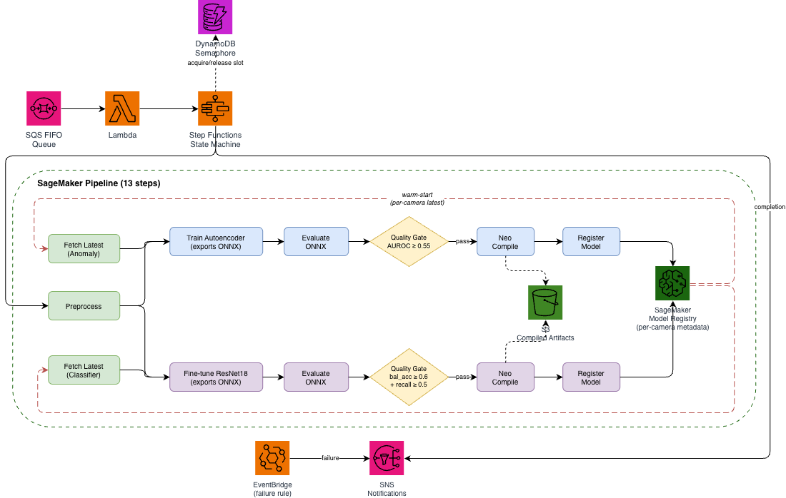

# Optional fleet scheduling

The core pipeline handles one camera's model lifecycle. This extension adds
SQS → Lambda → Step Functions scheduling, a DynamoDB lease table, and SNS
completion/failure notifications.



## Enable the extension

After completing the README deployment, use the same profile, Region, and image:

```bash
cdk deploy --all --require-approval never -c fleet=true -c max_concurrency=1 \
  -c "training_image_digest=$(cat .training-image-digest)"
python scripts/submit_batch.py --camera-ids cam-001 cam-002 --dry-run
python scripts/submit_batch.py --camera-ids cam-001 cam-002
```

Start with concurrency 1. Increase it only when the training, processing, and Neo
quotas cover the desired capacity. Keep `-c fleet=true` on later deployments;
omitting it does not remove an already deployed fleet stack.

For real data, pass the downloader's publication index:

```bash
python scripts/submit_batch.py --camera-ids cam-001 cam-002 \
  --publication-index data/bccd/publication_index.json
```

Each camera must have an entry in the index. The small BCCD dataset limits how
many viable camera partitions the downloader can produce.

The submitter prints a batch ID. Reuse it with `--batch-id` when retrying a failed
submission; choose a new ID for a deliberate retrain. Each camera receives its own
stable request ID, so queue redelivery cannot silently duplicate training.

Find the state machine through the stack outputs:

```bash
STATE_MACHINE_ARN=$(aws cloudformation describe-stacks --stack-name FleetCVOrchestrationStack \
  --query "Stacks[0].Outputs[?OutputKey=='StateMachineArn'].OutputValue" --output text)
aws stepfunctions list-executions --state-machine-arn "$STATE_MACHINE_ARN"
```

An execution's output contains its pipeline execution ARN. Pass it to
`scripts/run_pipeline.py --execution-arn ARN --output execution-camera.json`
to verify that camera's registered packages and Neo artifacts.

## Why the lease manager stays separate

Fleet concurrency control and retry recovery are part of this sample's purpose.
The implementation remains in `orchestration_stack.py` and `src/orchestration/`,
and is deployed only with `fleet=true`. Readers can first learn the ML lifecycle
without needing to understand its distributed ownership protocol.

Each execution owns one of a fixed number of slots. DynamoDB transactions claim
the slot and ownership record together. Retried acquire/release requests are
idempotent. A start token is recorded before calling SageMaker so recovery can
identify an execution whose successful response was lost.

Release requires confirmation that the parent pipeline and any Neo child jobs
have finished. An unreadable status retains the slot. A scheduled reconciler and
terminal Step Functions events revisit retained ownership. Age triggers a check;
it never expires ownership on its own.

These checks are retained because a simple increment/decrement counter can
miscount after a lost response. The simplification is an optional deployment
boundary, shorter explanations, and a focused suite of behavioral tests.
The shared `neo_jobs.py` also supplies compilation job identity to the core
pipeline; the training image copies that helper without deploying fleet services.

## Capacity and backlog limits

The cap applies to executions started through this extension. Direct pipeline
starts bypass it. It also does not reserve SageMaker instances or Neo capacity.

The dispatcher starts a state machine for each request. Waiting requests poll for
a slot every 30 seconds, up to 480 attempts (four hours). Large backlogs therefore
consume Step Functions transitions and can time out before obtaining capacity.
For sustained workloads of thousands of devices, adapt dispatch to leave pending
work in SQS until capacity is available. This sample demonstrates per-device
orchestration; it does not establish a tested thousand-device throughput.

## Recovery and cleanup

Stop producers before cleanup. Let the queue drain before disabling consumption
if its requests should still run. `cleanup.py` closes admission and disables
consumption automatically, so queued requests will remain queued once cleanup
starts. The main README describes deletion and verification.

Inspect leases and request reconciliation:

```bash
LEASE_FUNCTION=$(aws cloudformation describe-stacks --stack-name FleetCVOrchestrationStack \
  --query "Stacks[0].Outputs[?OutputKey=='LeaseFunctionName'].OutputValue" --output text)
LEASE_TABLE=$(aws cloudformation describe-stacks --stack-name FleetCVOrchestrationStack \
  --query "Stacks[0].Outputs[?OutputKey=='LeaseTableName'].OutputValue" --output text)
aws dynamodb scan --table-name "$LEASE_TABLE" --consistent-read
aws lambda invoke --function-name "$LEASE_FUNCTION" \
  --cli-binary-format raw-in-base64-out \
  --payload '{"action":"reconcile"}' /tmp/fleet-reconcile.json
cat /tmp/fleet-reconcile.json
```

Check both Lambda's `FunctionError` field and the response payload; delivery alone
does not establish success. A named reconciliation request checks a fresh lease
immediately: `{"action":"reconcile","ExecutionName":"NAME"}`. A general sweep
normally waits until the lease is stale or marked for recheck.

For unresolved compilations, the `inspect_compilation_submissions` action with
`ExecutionName` reads submission records and their observed job states. Preserve
the lease while the outcome remains unknown. The handler also provides explicit
adjudication actions requiring operator identity and evidence; use those only
after establishing that the specific submission never created a job.
See the action contracts in `src/orchestration/lease_handler.py`.

To discard pending requests intentionally, retrieve `QueueUrl` from the stack
and use `aws sqs purge-queue --queue-url URL`. Allow already started state
machines to finish before rerunning cleanup.

## Change concurrency or resume after cleanup

Changing capacity while slots are held is unsupported. Stop producers, then:

```bash
python scripts/cleanup.py --close-for-capacity-change
# Let previously admitted work finish; reconcile retained ownership if needed.
python scripts/cleanup.py --preflight-capacity-change
```

Proceed only when the preflight succeeds and admission remains closed. Redeploy
with the desired `-c max_concurrency=N`, `-c fleet=true`, and the image digest.
To resume, invoke the lease handler's `reopen_admission` action and verify its
`reopened: true` response. Then enable the event source mapping identified by
the queue ARN and `QueueTriggerFunctionName` output, and wait for `Enabled`
before submitting another batch. Do not reopen during destruction.

This version assumes a fresh deployment. For an older deployment with a different
lease schema, drain and destroy that version using its own checkout before
deploying this one.
